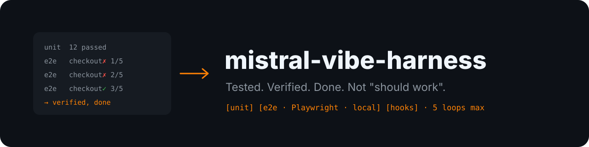

# mistral-vibe-harness 🧪 — Tested, verified, done

<p align="center">
  <picture>
    <source media="(prefers-color-scheme: light)" srcset="docs/assets/banner-light.svg">
    
  </picture>
</p>

<p align="center">
  <a href="LICENSE"></a>
  <a href="https://agentskills.io"></a>
  <a href="#installation"></a>
  <a href="https://github.com/librehubstore/mistral-vibe-harness/stargazers"></a>
  <a href="https://github.com/librehubstore/mistral-vibe-harness/commits/main"></a>
</p>

**mistral-vibe-harness** is an open-source agent skill that puts a harness on **Mistral Vibe**: read the code before touching it, plan with a todo list, write unit tests on every change, run **Playwright e2e tests in Docker on your own server over SSH**, and loop fix → validate until it's green. It works with any agent that supports the `SKILL.md` format (Claude Code, Codex, Cursor, Gemini CLI, GitHub Copilot, OpenCode, Windsurf…).

**No more "this should work".** A change is done when its tests pass, not when the agent says so. After 5 failed fix attempts, the agent stops, explains what it tried, and asks you what to do, instead of looping forever or quietly skipping the test.

[What it enforces](#what-the-skill-enforces) · [Installation](#installation) · [E2E setup](#e2e-test-setup-remote-docker-over-ssh) · [Contributing](#contributing) · [License](LICENSE)

## What the skill enforces

| Rule | Detail |
|------|--------|
| Read before edit | Never edit a file it hasn't read; never guess an API, import or flag — search for it. |
| Planning | Todo list as soon as a task has 3+ steps or touches 2+ files, one item in progress at a time. |
| Unit tests | On **every** code change: new or updated test, nominal case + edge case, full suite green before finishing. |
| Playwright e2e tests | On every important functional feature (page, form, auth, payment, multi-step flow…). |
| Remote Docker execution | E2E tests run in the official Playwright image on your server, over SSH. |
| Fix → validate loop | Up to **5 iterations**, each with a different hypothesis. After 5 failures: stop, explain, ask the user. |
| Integrity | Fix the code, not the test. No `.skip`, no `xfail`, no loosened assertions. |
| Finish | Final checklist: every todo closed, tests run and green, honest report. |

## Repository layout

```
skills/
  mistral-vibe-harness/
    SKILL.md        # the skill (frontmatter + instructions)
docs/assets/        # README banners (dark / light)
README.md
LICENSE
```

## Installation

### Mistral Vibe

Vibe loads skills from `~/.vibe/skills/` (global) or `.vibe/skills/` (project).

**Linux / macOS**

```bash
git clone https://github.com/librehubstore/mistral-vibe-harness.git
mkdir -p ~/.vibe/skills
cp -r mistral-vibe-harness/skills/mistral-vibe-harness ~/.vibe/skills/
```

**Windows (PowerShell)**

```powershell
git clone https://github.com/librehubstore/mistral-vibe-harness.git
New-Item -ItemType Directory -Force "$HOME\.vibe\skills" | Out-Null
Copy-Item -Recurse mistral-vibe-harness\skills\mistral-vibe-harness "$HOME\.vibe\skills\"
```

For a single project, copy into `<project>/.vibe/skills/` instead.

Check: start `vibe` and give it a coding task — you should see `Loading skill: mistral-vibe-harness` before its first edit.

### Other agents — via the `skills` CLI (recommended)

The [`skills`](https://skills.sh) CLI installs into the right folder for each agent:

```bash
# pick the agents interactively
npx skills add librehubstore/mistral-vibe-harness

# global install for one agent
npx skills add librehubstore/mistral-vibe-harness -g -a claude-code

# all detected agents, no prompts
npx skills add librehubstore/mistral-vibe-harness --all
```

Agent IDs: `claude-code`, `codex`, `cursor`, `gemini-cli`, `github-copilot`, `opencode`, `windsurf`, `cline`, `amp`…

### Other agents — manual install

Copy `skills/mistral-vibe-harness/` into the agent's skills folder:

| Agent | Project | Global |
|-------|---------|--------|
| Mistral Vibe | `.vibe/skills/` | `~/.vibe/skills/` |
| Claude Code | `.claude/skills/` | `~/.claude/skills/` |
| OpenAI Codex | `.codex/skills/` | `~/.codex/skills/` |
| Cursor | `.cursor/skills/` | `~/.cursor/skills/` |
| Gemini CLI | `.gemini/skills/` | `~/.gemini/skills/` |
| GitHub Copilot | `.github/skills/` | — |
| OpenCode | `.opencode/skills/` | — |
| Windsurf | `.windsurf/skills/` | — |
| Amp | `.agents/skills/` | — |

### Agents without skill support

Paste the body of `SKILL.md` (everything after the `---` frontmatter) into the agent's instruction file: `AGENTS.md`, `.cursorrules`, `.windsurfrules`, `CONVENTIONS.md` (Aider), etc.

## Forcing the skill to load

An agent loads a skill only when it judges the task matches the description. If yours skips it on small changes, add this line to the project's `AGENTS.md` (or `CLAUDE.md`, `GEMINI.md`…):

```
Always load the mistral-vibe-harness skill before any code change.
```

## E2E test setup (remote Docker over SSH)

On the first e2e run in a project, the agent asks for:

- server host
- SSH user
- port (default 22)
- private key path

It stores them in `.e2e-ssh.env` at the project root and adds that file to `.gitignore`:

```
E2E_SSH_HOST=203.0.113.10
E2E_SSH_USER=deploy
E2E_SSH_PORT=22
E2E_SSH_KEY=~/.ssh/id_ed25519
E2E_REMOTE_DIR=~/vibe-e2e/my-project
```

### Server prerequisites

1. **SSH key access.** Passwords are never accepted: the agent's shell is non-interactive. Install your key:
   ```bash
   ssh-copy-id -i ~/.ssh/id_ed25519.pub -p 22 deploy@203.0.113.10
   ```
   On Windows, without `ssh-copy-id`:
   ```powershell
   type $HOME\.ssh\id_ed25519.pub | ssh -p 22 deploy@203.0.113.10 "mkdir -p ~/.ssh && cat >> ~/.ssh/authorized_keys"
   ```
2. **Docker without sudo** for that user:
   ```bash
   sudo usermod -aG docker deploy   # then log out / back in
   ```
3. Check it works:
   ```bash
   ssh -o BatchMode=yes -p 22 deploy@203.0.113.10 "docker info --format '{{.ServerVersion}}'"
   ```

### How a run works

1. The code is sent with `tar | ssh` (without `node_modules`, `.git` or the SSH env file).
2. Tests run in `mcr.microsoft.com/playwright:v<version>-noble`, the same version as the project's `@playwright/test`. If the project has a `docker-compose` file, its services (DB, cache…) are started.
3. On failure, `test-results/` (traces, screenshots) is copied back with `scp` for analysis.

Containers are started with `--rm`. The agent never touches containers it didn't start.

## Contributing

Issues and PRs welcome. Keep the skill short and imperative: every line costs context in every session.

## License

[MIT](LICENSE)
